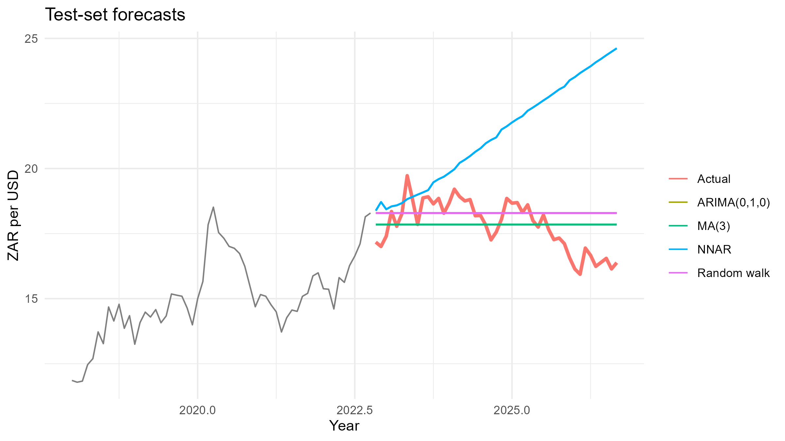
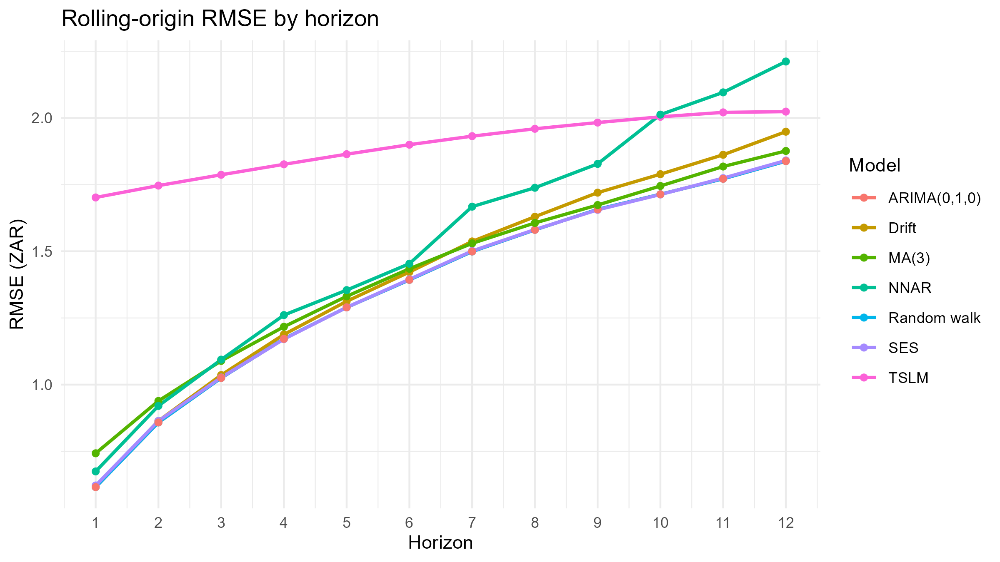
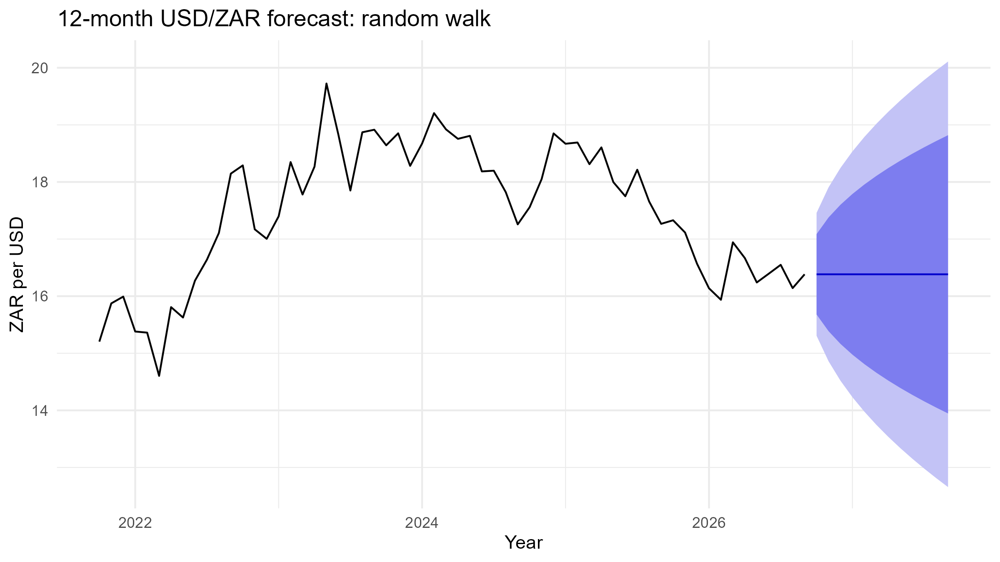

# Forecasting the USD/ZAR Exchange Rate in R

Can anything beat a random walk when forecasting the South African rand? This project compares benchmark, ARIMA, exponential smoothing, moving-average, regression, neural-network and GARCH models on monthly USD/ZAR data (Jan 2010 – Sep 2026), using both a single train/test split and rolling-origin cross-validation.

**Short answer: no.** No model beat the naive (random-walk) forecast out-of-sample. The selected model is ARIMA(0,1,0), and the 12-month forecast is flat at 16.38 ZAR per USD with a 95% interval of 12.66 to 20.11.



---

## Table of contents

- [Data](#data)
- [Methods](#methods)
- [Results](#results)
  - [Test set](#test-set-47-months-one-forecast-origin)
  - [Rolling-origin cross-validation](#rolling-origin-cross-validation-rmse-by-horizon)
  - [Key findings](#key-findings)
  - [Final forecast](#final-forecast)
- [Interactive dashboard (Tableau Public)](#interactive-dashboard-tableau-public)
- [Interpretation](#interpretation)
- [Limitations](#limitations)
- [Repository structure](#repository-structure)
- [How to run](#how-to-run)
- [References](#references)
- [Author](#author)

---

## Data

| Item | Detail |
|---|---|
| Series | USD/ZAR monthly closing rate, 201 observations (Jan 2010 – Sep 2026) |
| Source | [Investing.com](https://www.investing.com/currencies/usd-zar-historical-data), monthly CSV export |
| Train / test | Train Jan 2010 – Oct 2022 (154 months), test Nov 2022 – Sep 2026 (47 months) |
| Optional predictors | Gold, Brent crude, VIX (Investing.com); US dollar index, SA–US 10-year yield spread, Brazilian real (FRED) |

The raw data are not committed to this repository (check the source's terms of use). Download the CSV yourself and place it in `data/`, as described below.

---

## Methods

1. **Exploratory analysis**: time plot, distribution, STL decomposition.
2. **Benchmarks**: mean, naive, random walk with drift, simple exponential smoothing (SES), ETS.
3. **ARIMA**: ADF and KPSS tests, differencing, ACF/PACF, candidate models ARIMA(0,1,0), (1,1,0), (0,1,1), (1,1,1) and `auto.arima`, compared by AIC/BIC and test accuracy, with Ljung-Box residual diagnostics.
4. **Moving average**: window *k* chosen by rolling-origin CV on the training data only.
5. **Regression**: trend and seasonal regression (`tslm`), and a regression of monthly log changes on lagged predictor changes (gold, Brent crude, VIX).
6. **Neural network**: `nnetar` on the monthly differences, accumulated back to levels (averaged over 50 networks).
7. **GARCH(1,1)** with Student-t errors on monthly log returns, to assess time-varying volatility.
8. **Evaluation**: RMSE, MAE, MAPE and MASE on the test set, plus rolling-origin RMSE for horizons 1–12 months (initial window of 60 months).

---

## Results

### Test set (47 months, one forecast origin)

| Model | RMSE | MAE | MAPE (%) | MASE |
|---|---|---|---|---|
| MA(3) | 0.955 | 0.811 | 4.61 | 0.543 |
| SES | 1.059 | 0.835 | 4.86 | 0.559 |
| **Naive = ARIMA(0,1,0) = MA(1)** | **1.062** | **0.837** | **4.87** | **0.560** |
| MA(12) | 1.835 | 1.592 | 8.68 | 1.065 |
| TSLM (trend) | 2.039 | 1.519 | 8.89 | 1.016 |
| TSLM (trend + season) | 2.043 | 1.516 | 8.88 | 1.015 |
| Drift = auto.arima (ARIMA(0,1,0) with drift) | 2.743 | 2.178 | 12.72 | 1.458 |
| ETS(M,A,N) | 2.855 | 2.275 | 13.27 | 1.523 |
| Neural network (NNAR) | 4.566 | 3.691 | 21.46 | 2.470 |
| Mean | 5.682 | 5.601 | 31.22 | 3.748 |

MA(3) has the lowest single-split error, but this is a path-specific result. In rolling-origin evaluation it is worse than naive at every horizon (below), and cross-validation on the training data selected *k* = 1, which is the naive forecast.

### Rolling-origin cross-validation (RMSE by horizon)

| Model | h = 1 | h = 3 | h = 6 | h = 12 |
|---|---|---|---|---|
| **Naive (= MA(1))** | **0.616** | **1.025** | **1.393** | **1.838** |
| SES | 0.622 | 1.027 | 1.395 | 1.841 |
| Drift | 0.618 | 1.036 | 1.422 | 1.949 |
| MA(3) | 0.742 | 1.089 | 1.434 | 1.876 |
| NNAR | 0.691 | 1.110 | 1.487 | 2.247 |
| TSLM | 1.702 | 1.787 | 1.900 | 2.024 |



### Key findings

- **The series is a unit-root process.** ADF on the level: p = 0.338; KPSS: statistic 2.82, p < 0.01; ADF on the first difference: p < 0.01. One difference is enough.
- **AR and MA terms add nothing.** ARIMA(0,1,0) has the best BIC (255.8) and is essentially tied on AIC (252.8 vs 252.3 for the drift model). Residuals show no autocorrelation (Ljung-Box p = 0.70).
- **Drift hurts.** The estimated drift is 0.070 ZAR per month (s.e. 0.044, t = 1.58, not significant). Projecting it forward gave a test RMSE of 2.74 against 1.06 for the driftless model.
- **Predictor regression does not beat naive.** Regressing monthly log changes on the previous month's changes in gold, Brent crude and the VIX gave no significant coefficients (all p > 0.16; overall F-test p = 0.576; adjusted R² < 0). In a one-step-ahead test the regression had higher error than the naive forecast (RMSE 0.578 vs 0.548).
- **Weak volatility clustering.** In the GARCH(1,1) fit, no variance parameter is significant (α = 0.10, p = 0.44; β = 0.49, p = 0.52), persistence is low (α + β = 0.59), and residual diagnostics are clean. The squared-residual Ljung-Box test on the training residuals is not significant (p = 0.176). GARCH adds little over constant-variance intervals here.
- **Neural network and trend models overfit patterns that did not persist**, ending up worse than naive at every horizon.

### Final forecast

ARIMA(0,1,0) refitted on the full series: **16.38** for every month from Oct 2026 to Sep 2027, with 80% intervals widening from 15.68–17.09 (1 month ahead) to 13.95–18.82 (12 months), and 95% intervals from 15.31–17.46 to 12.66–20.11.



---

## Interactive dashboard (Tableau Public)

The analysis produces three tidy CSVs designed for a Tableau dashboard:

| File | Contents | Tableau sheet |
|---|---|---|
| `figures/tableau_timeseries.csv` | Date, Value, Series (Actual + 5 forecasts), Set (Train/Test) | Time series of actual vs forecasts |
| `figures/tableau_metrics.csv` | Model, Metric (RMSE/MAE/MAPE/MASE), Value | Accuracy bar chart |
| `figures/tableau_cv.csv` | Model, Horizon (1–12), RMSE | Rolling-origin RMSE by horizon |

**Open the dashboard:** [Tableau Public — USD/ZAR Forecasting](https://public.tableau.com/views/usdzar-forecasting/Home)

The dashboard has three sheets and a shared title block:

1. **Time series** — USD/ZAR (dark grey) with the random walk (accent orange), MA(3), ARIMA(0,1,0) and NNAR forecasts overlaid; the test period is shaded grey.
2. **Accuracy bars** — models ranked by RMSE, coloured by deviation from the random-walk benchmark (green = better, red = worse). A metric filter lets the viewer switch between RMSE / MAE / MAPE / MASE.
3. **Rolling-origin RMSE** — RMSE curves for horizons 1–12, with the random walk highlighted.

## Interpretation

These results match a long-standing finding in the exchange-rate literature (Meese and Rogoff, 1983): fundamentals-based and time-series models struggle to beat a random walk out-of-sample, especially at horizons under a year. The practical conclusion is that the best point forecast of the rand is its current value, and the main value of a model lies in honest uncertainty bands, not in a better central forecast.

---

## Limitations

- One currency pair and one split date; the single test window is only one path of the rand.
- The predictor regression tests a small set of variables at a one-month lag. Contemporaneous relationships, other predictors (for example a US dollar index, yield spreads, or capital flows) and longer horizons were not evaluated in the results above.
- The neural network uses default `nnetar` settings with no tuning; cross-validation of it uses 10 networks per fit for speed.
- The Nyblom stability test in the GARCH output flagged mild parameter instability (joint statistic 1.49), so a single parameter set may not fit the whole period.

---

## Repository structure

```
.
├── README.md
├── usdzar_forecasting.R     # full analysis: run top to bottom
├── get_predictors.R         # builds the optional regression predictor files
├── data/                    # put input CSVs here (not committed)
├── figures/                 # plots written by the analysis script
│   ├── *.png                #   static figures
│   └── tableau_*.csv        #   tidy tables for the Tableau dashboard
└── results/                 # tables (CSV), forecast, session info
```

---

## How to run

1. Install [R](https://cran.r-project.org/) (developed on R 4.5.2) and, optionally, RStudio.
2. Download USD/ZAR monthly data from Investing.com and save it as `data/USD_ZAR Historical Data.csv` (columns `Date` and `Price`; dates are month/day/year).
3. *(Optional)* build the regression predictors:

   ```r
   source("get_predictors.R")
   ```

   This downloads the FRED series and, if you saved the Investing.com gold, Brent and VIX monthly CSVs in `data/` (file names are listed at the top of the script), builds `data/predictors_investing.csv` too. Set `PREDICTORS` at the top of `usdzar_forecasting.R` to the file you want to use. The results above use the gold, Brent and VIX set (`predictors_investing.csv`).

4. Run the analysis:

   ```r
   source("usdzar_forecasting.R")
   ```

   Packages `tidyverse`, `forecast`, `tseries` and `patchwork` install automatically; `rugarch` is optional (GARCH section). Set `RUN_NN_CV <- FALSE` to skip the slow neural-network cross-validation. The script also writes the three `figures/tableau_*.csv` files used by the dashboard.

5. *(Optional)* rebuild the Tableau dashboard from `figures/tableau_*.csv` — see the [Interactive dashboard](#interactive-dashboard-tableau-public) section.

Random seeds are fixed (`set.seed(123)`), but neural-network results can differ slightly across package versions and platforms. `results/session_info.txt` records the exact versions used in your run.

---

## References

- Meese, R. A. and Rogoff, K. (1983). Empirical exchange rate models of the seventies: Do they fit out of sample? *Journal of International Economics*, 14(1–2), 3–24.
- Hyndman, R. J. and Athanasopoulos, G. *Forecasting: Principles and Practice* (3rd ed.). OTexts. <https://otexts.com/fpp3/>

---

## Author

Neo Mthembu · [GitHub](https://github.com/neomthembu25-maker) · [Portfolio](https://datascienceportfol.io/neomthembu25) · [LinkedIn](https://linkedin.com/in/neo-mthembu-902b4621a)
